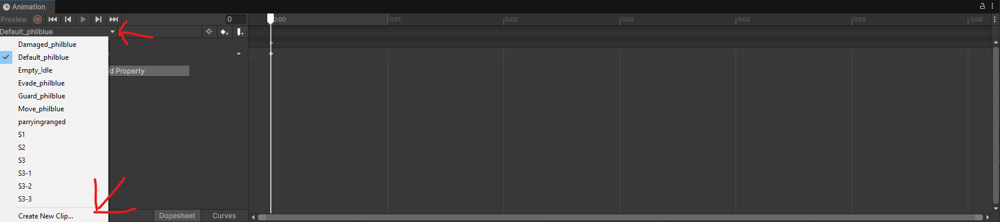
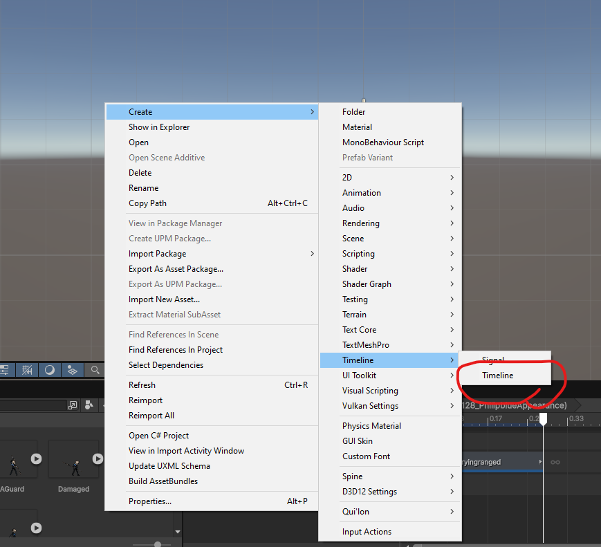

# CustomAssetLoader

Allows the loading of your own custom bundles completely independent from anything in game (unlike Motions)

**What can currently be replaced/added?**

- Gameobjects
- Sprites
- BattleEffectLists
- FMod banks
- Shaders (immersive plagiarism reference)

**How do I utilize this in my mod?**

All bundles must reside within a mod's `custom_bundles` folder.

Alongside this, each bundle must come with a `asset_manifest.json` file, which can then mark objects and match them to the previously discussed types. (For custom Sounds, use `custom_banks` instead, or just use CSound you MF)

**How do I create a manifest?**

- The example's on the Github, but for convenience, I will go over it:

```json
{
  "overrides": [
    {
      "label": "SD_Personality",
      "resourceId": "10805_Ishmeal_FairyAppearance",
      "bundle": "__data",
      "assetPath": "Assets/Resources_moved/Prefab/SD/Personality/10805_Ishmeal_FairyAppearance.prefab",
      "assetType": "GameObject"
    }
  ]
}
```

- Label: The category of the object (i.e abnormalities, personalities, etc etc)
- resourceId: The specific ID that is sent to the game (for custom IDs, you use "SD_Personality" on the label, then input your resourceId by putting a nonexistant path i.e 9999_SigmaSogmaApperacne)
- bundle: The bundle name within the folder.
- assetPath: The path inside of the bundle that leads to the requested asset.
- assetType: The previous types of GameObject, Sprite, BattleEffectList, etc. Defaults to GameObject.

**How do I find which Label I need???**

Labels and resourceId pairs are used in game, so you can either look at existing mods or enable verbose logging in the config settings.

**How do I add FMod Sound banks?**

1. Build the FMOD project and export the `.bank` files.
2. Put them in the `custom_banks` folder.
3. Make sure the `.strings` is present alongside the bank, then you should be able to use them.

**How do I use shader remapping?**

Use Immersive Plagiarism by the naenae.

# Custom Appearance Basics

First things first, this guide assumes you have one of Doppel's templates. As such, switch the color space to Gamma. This can be done via navigating to Project Settings -> Player -> Other Settings -> Color Space

Now that you've done that, lets go over what you'll likely see.


I'll assume you need no introduction to most of the UI elements. If you do, go use Custom Motions, which is much easier and convenient.

Now, let's navigate to the basics. Click the `resources_moved` folder, `prefab`, `SD`, `Abnormality`, and then drag the appearance prefab onto the hierarchy like so:


Great. Now we have the prefab appearance. Here resides all of our VFX, alongside various items like spine objects, pivots, blood effects, mang effects, unit scripts, etc. 

I'll briefly cover some of the materials that should be there.

On the main appearance object, you should find:
- A `CharacterApperacneResiver` script, which is required for the game engine to use your appearance properly. Within it's `appearance` slot, set a reference to your prefab/gameobject that it exists under.
- Depending on the copy of the template, you will find an `AbnormalityAppearnce` script. Every field in there is self explanatory, so I won't bother. Just make sure to fill out every field needed like `Char Info`, `Motion List` to bind timelines, and `Sprenderer_charactermotion` to the sprite renderer on your `SpRenderer` object. Said `AbnormalityAppearnce` script can also be swapped for a `CharacterAppearance` script if you want to work with ID appearances; If you do, be sure to also remove the abnormality sprites from the `SpineRenderer` object and add a `CharacterSpineSkin` script in their place.
- A `PlayableDirector`, leave it as is (and replace the playable later once you actually begin work)
- An `Animator`, which you will use when you create a new `Animator Controller` component.
- The `CharacterAppearanceBlood` script, which allows you to edit various properties of blood on the unit.
- The `AbnormalityParts` script, which allows for management of differing phases and the like on an abnormality.
- The `CharacterAppearanceMangController` script, which has a list of `Mang Controllers`. Every Mang VFX needs to have a new mang controller entry that is registered here. Alongside this, the `skill infos` section also allows for activation of mangs on specific Skill IDs.
- And last but not least, the `CharacterAppearanceUpdateBuffState` script, which allows you to activate effects based on the stack of a buff. Populate the `Active Effect` list with a reference to a VFX prefab in order to activate it.

Within `ScaleAndPositionPivot`, and `PivotForAnim`, you will find:
- `SpinePivot`, which holds a `SpineRenderer`.
- `SpRenderer`, which holds all the blood renders and is the unit's Sprite Renderer, its very important that you make sure that this object has a `Sprite Mask` component in it, if it doesnt have it the game shits itself badly.
- `DefaultEffectPivot`, which is where all VFX should be parented to.
- `CharacterCenterPoint`, which is pretty self explanatory.
- `CharacterHeightPoint`, which defines the the position of the coin and skill UI on your appearance.

Depending on the copy of your template, you may also find other anchor objects. Those are not required, but you may look at them if you wish.

Navigate back to the `assets` folder, then go to `art`, `qui'lon`, `Animators`, `Phase1`.

Within this folder, you will find the `Animation Controller`. Rename it to match your project and make sure its set on your animator inside your appearance object. It's state is fine as is for now.

# Animationclips

Animationclips are used to make the sprite animations for your appearance.

Before doing anything, open up the animation window by pressing `Ctrl + 6`, click on your appearance object in the hierarchy window, then press on the arrow on the top left corner of the window and click `Create New Clip`, this is where all of your sprite animations will be made. *if you are prompted to create a new animator, do NOT do it, the only animator for the character sprites should be on the main appearance object*



When doing your first animation clip, make sure that when you add the `sprite` property of the sprite renderer that is inside of `SpRenderer` to ensure correct scaling. To actually use your sprites in an animationclip you select them in the assets window, change their type to `Sprite (2d and UI)`, change `Sprite Mode` to Single and now you should be able to simply drag them into the animationclip. *its also recommended to set the pivot point of your sprites to where the ground would be and between the legs for correct positioning on certain in game effects*

# Timeline making

Timelines are what will contain the actual skill animations, including movement, camera and damage markers.

First things first, right click on the assets tab and click to create a new timeline asset.



Then, drag the timeline asset you are planning on editing into the `playable director` of your appearance, this needs to be done to any timeline you are editing so that you can see the movement previews and properly parent the tracks.

Now, youll want to right click on the timeline, you will see something similar to this:

[](docs/assets/timelinewindow.png)

These are the types of tracks that are used for creating motions, in this guide ill mention only the most important ones. Those are:

-`Animation` track. You should set its animator to the one in your appearance object, when you do so you should be able to just drag in your animationclips into this track.

refanimatiosetup

-`Character Appearance Timeline` track. You should set this one to your character appearance, by right clicking on this track in the timeline you will see a giant list of options, which may be intimidating, but for now the main ones you need to think about are these:

charapref

When you click on any of these you will notice a marker has been added to your timeline, this marker is what tells the game the time that it has to do what the marker says, every marker has its own settings when you click on them, but most are similar to custom motions so i believe you can figure it out :steamhappy:

-`Skill Give Timing` track. You should set this one to your character appearance; This one is pretty similar to the one above, it just has a different set of markers that it uses, to see them scroll down the menu when you right click the track a little, once again you dont need to worry about all of them, the ones below are the ones you should think about mostly, and once again they work pretty similarly to motions just with markers in the timeline itself instead of values inside a json file.

skilltimingref

-`Effect Activate` track. Same setup as the ones before. This is the track that controls vfx activation, to use a vfx on a timeline you need to go to its object and add a `CharacterAttackEffect` or `CharacterAttackEffectV2` script on it, then go back to the timeline and right click on the track, you should see a option to add from character attack effect, just add it by clicking there and it should work correctly.

-`On Battle Cam Zoom` and `On Battle Cam Rotate` tracks. Same setup. These are the tracks that control the zooms and rotates (duhh), to use these you simply right click on them in the timeline and you should have a option to add either a battle cam zoom clip or a battle cam rotate clip. these work a bit differently from the skill give timing or the appearance track, they create clips instead of markers, by clicking in the clips you should see the camera options, once again the setup for them is similar to motions, the main change is that the duration for the zoom or rotate is set by the actual lenght of the clip in the timeline, so it makes timing the camera movement way easier.


**NOTE**: When making a new TimelineAsset, it needs to be added to the Bindings section on the appearance prefab's `PlayableDirector`. Every new motion also needs to exist on the prefab's `CharacterAppearance` script within it's `Motions List`. If the motion has a timeline, add it to the `Timeline Assets`. If you are using Spine instead, go to `Motion Objects` and enable the Spine Anim option.

# Hit checkers, visual effects

In order to add VFX, you must first parent the VFX to the prefab's DefaultEffectPivot transform. Once that's done, the VFX parent object must have the script Character Attack Effect. On said script, you must link the `This Particle` field to the particlesystem. Once that's done, navigate back to the TimelineAsset, then, right click the `Effect Activate Timeline Track`'s track -> `Add from Character Attack Effect` -> Your VFX. Scale and position as needed.

For hit checkers, you must simply right click the `Skill Give Timing Track`, and select from the list of adds. Alternatively, copy paste an existing give damage timing from the preset TimelineAssets.

